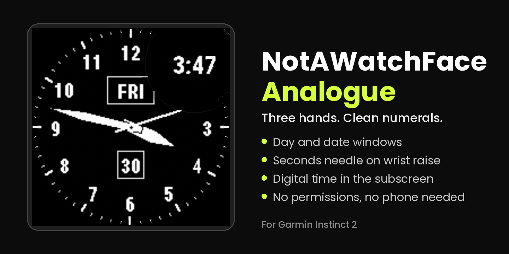
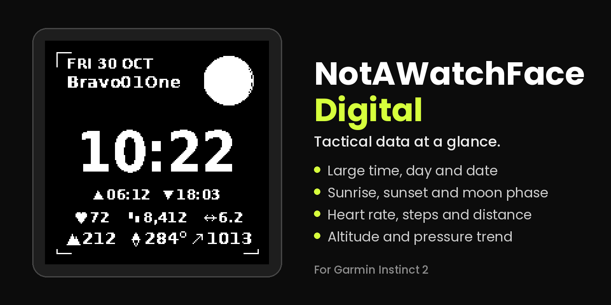

# NotAWatchFace-Garmin

Two watch faces for the Garmin Instinct 2 Solar Tactical Edition (Connect IQ
device `instinct2`, 176 x 176, 2-colour memory-in-pixel display), written in
Monkey C. Each face comes with a line-by-line guide that explains every file,
so the code can be read as a course.

| Face | Version | What it shows | Folder |
| --- | --- | --- | --- |
| Analogue | 1.0.2 | Hour and minute hands, a seconds needle for about 10 seconds after a wrist raise, numerals 1-12, day and date windows, digital time in the round subscreen | [`NotAWatchFaceAnalogue`](NotAWatchFaceAnalogue) |
| Digital | 1.0.3 | Large time, day and date, a text label, moon phase in the round subscreen, sunrise and sunset, heart rate, steps, distance, altitude, last compass reading, pressure with a 3-hour trend | [`NotAWatchFaceDigital`](NotAWatchFaceDigital) |

The Analogue face asks for no permissions. The Digital face asks for
`Positioning` (last known GPS position, for sunrise and sunset) and
`SensorHistory` (pressure trend and altitude). Neither face uses the network
or the phone.

## Preview





These are rendered previews made for a store listing. They are not captures
from the simulator or from a watch, and real captures are not included yet.

## Repository layout

```text
NotAWatchFace-Garmin/
  LICENSE, NOTICE            Apache-2.0 and third-party credits
  NotAWatchFaceAnalogue/     manifest.xml, monkey.jungle, source/, resources/
  NotAWatchFaceDigital/      the same, plus source/Astro.mc and source/Settings.mc
  docs/                      one how-to-code guide per face
  assets/store-listing/      cover and hero images
```

Each face folder also holds its own `README.md`, `INSTALL.md` and
`QA-REPORT.md`.

## Build and install

The `INSTALL.md` in each face folder walks through the SDK, a developer key,
the build, the simulator and the USB copy to the watch. The short version:
build each folder for
`instinct2` with Garmin's Connect IQ SDK and Monkey C extension, then copy the
`.prg` file into `GARMIN/APPS` on the watch.

**Bring your own developer key.** Every build is signed with a key that you
generate yourself. No key is included in this repository, and `.gitignore`
blocks the usual key file names. Keep your key private and backed up.

The label under the date on the Digital face is a single line in
[`NotAWatchFaceDigital/source/Settings.mc`](NotAWatchFaceDigital/source/Settings.mc).

## Learn from the code

| Guide | Covers |
| --- | --- |
| [`docs/NotAWatchFaceAnalogue-how-to-code-it.md`](docs/NotAWatchFaceAnalogue-how-to-code-it.md) | Manifest, resources, the App class, the View (dial, hands, seconds needle, collision helpers), build and install |
| [`docs/NotAWatchFaceDigital-how-to-code-it.md`](docs/NotAWatchFaceDigital-how-to-code-it.md) | The same, plus sensor reading, caching, the pressure trend, and the sunrise, sunset and moon maths in `Astro.mc` |

The code blocks in both guides were compared with the source files in this
repository. Statements about Monkey C language rules that could not be
checked against Garmin's documentation are marked as such in the text.

## Testing status

`QA-REPORT.md` in each face folder records what was checked and how. The
layout checks use a model of the drawing code with stand-in fonts, which is
not Garmin's simulator, so the simulator checklist in `INSTALL.md` still
applies.

## Licence and credits

Released under the [Apache License 2.0](LICENSE); the documentation is part of
the project and is covered by the same licence. [`NOTICE`](NOTICE) credits the
published almanac method behind the sunrise and sunset code and carries the
trademark notice below.

Garmin, Instinct and Connect IQ are trademarks of Garmin Ltd. or its
subsidiaries. This project is independent and is not affiliated with,
endorsed by or sponsored by Garmin. Those names appear only to say which
device and SDK the code is written for.
